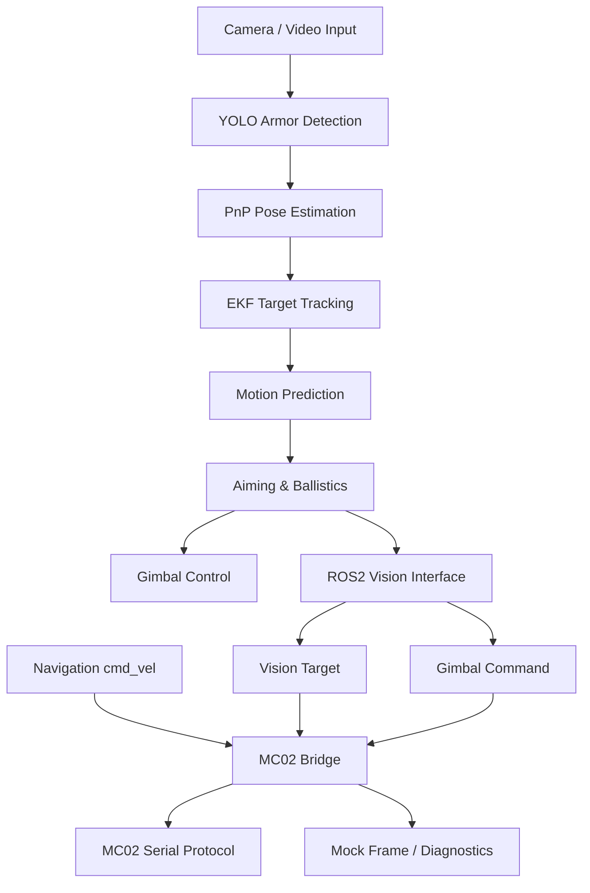
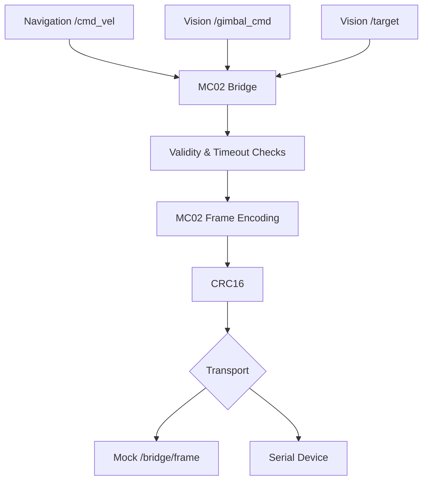

# Restar Vision 2025

### RoboMaster 机器人视觉自瞄与 ROS2 通信系统


## 📖 项目简介

**Restar Vision 2025** 是一套面向 RoboMaster 机器人竞赛的视觉感知、目标跟踪与云台控制系统，主要应用于哨兵机器人及其他具备自动瞄准需求的机器人平台。

项目基于 C++17 开发，以 OpenCV、OpenVINO、Eigen 和 ROS2 为核心技术栈，构建了从图像采集、装甲板识别、目标定位、运动状态估计到云台控制的完整处理流程。

在视觉算法方面，系统支持 YOLO 系列神经网络模型进行装甲板检测，结合 PnP 位姿解算、扩展卡尔曼滤波（EKF）、目标运动预测及弹道补偿，实现对动态目标的持续跟踪与瞄准。

在系统集成方面，项目采用模块化设计，提供 ROS2 通信接口、导航与视觉信息交互、MC02 串口通信桥接，以及面向无硬件环境的 Mock 测试与录像回放功能，便于算法开发、系统联调和机器人平台部署。

### ✨ 项目特性

* **高性能视觉检测**：支持 YOLOv5、YOLOv8、YOLO11 等目标检测模型，使用 OpenVINO 进行推理加速。
* **目标定位与跟踪**：利用 PnP 解算目标空间位置，结合 EKF 估计运动状态，实现连续目标跟踪。
* **目标运动预测**：基于目标运动模型预测未来位置，结合弹道模型计算云台瞄准角度。
* **ROI 区域检测**：支持指定感兴趣区域进行图像检测，减少不必要的图像处理区域。
* **ROS2 通信集成**：通过结构化 ROS2 消息发布目标状态和云台控制指令，实现视觉模块与其他机器人模块的信息交互。
* **导航与云台桥接**：通过 MC02 二进制通信协议汇总导航速度与云台控制数据，实现上位机与下位机之间的数据交互。
* **离线回放调试**：支持使用视频和姿态数据运行视觉算法，无需连接真实相机或机器人硬件。
* **模块化与可测试性**：提供独立通信工具、Mock 节点、协议测试和串口测试，便于分模块调试和验证。

---

## 🏗️ 系统架构

系统主要由视觉感知、目标状态估计、瞄准控制、ROS2 通信和底层硬件通信五部分组成。



### 1. 视觉感知模块

负责从工业相机或视频文件中获取图像，使用神经网络检测装甲板目标，并提取目标关键点信息。

主要功能包括：

* 工业相机图像采集；
* YOLO 装甲板识别；
* ROI 区域检测；
* 目标置信度筛选；
* 检测结果可视化。

### 2. 目标定位与跟踪模块

利用相机标定参数和检测结果计算目标空间位置，并通过滤波算法估计目标运动状态。

主要功能包括：

* PnP 位姿解算；
* 目标坐标计算；
* EKF 状态估计；
* 目标匹配与跟踪；
* 运动状态预测。

### 3. 瞄准控制模块

根据目标位置和运动预测结果计算瞄准角度，并结合云台状态与弹道模型进行控制补偿。

主要功能包括：

* 目标未来位置预测；
* 弹道补偿；
* 云台 Yaw / Pitch 角度计算；
* 云台运动控制；
* 目标丢失处理。

### 4. ROS2 通信模块

使用 ROS2 实现视觉系统与导航、决策和控制模块之间的数据交互。

通信模块支持：

* 目标位置信息发布；
* 云台控制指令发布；
* 敌方机器人状态订阅；
* 目标选择信息订阅；
* 输入数据有效性检查；
* 消息超时处理；
* ROS2 节点生命周期管理。

### 5. MC02 通信模块

将 ROS2 中的导航速度和云台控制数据转换为 MC02 二进制协议帧，通过串口发送至下位机。

支持：

* 导航速度信息编码；
* 云台角度指令编码；
* CRC16 校验；
* 串口通信；
* 超时与失效处理；
* 断线重连；
* Mock 数据发布与接收；
* 通信状态诊断。

---

## 🧠 视觉算法

### 装甲板检测

项目采用 YOLO 系列目标检测模型，结合 OpenVINO 推理框架实现装甲板检测。

支持的模型包括：

* YOLOv5
* YOLOv8
* YOLO11

检测过程主要包括图像预处理、网络推理、检测结果解析及目标筛选。

通过配置文件可以调整模型路径、推理设备和置信度阈值等参数。

### ROI 区域检测

系统提供 `detect_with_roi(...)` 接口，可以针对指定图像区域执行检测。

ROI 功能适用于目标已经被定位或预测的场景，通过缩小检测范围减少无关区域的计算量。

相关配置示例：

```yaml
roi:
  x: 420
  y: 50
  width: 600
  height: 600

use_roi: false
```

其中：

* `x`、`y`：ROI 左上角坐标；
* `width`、`height`：ROI 的宽度和高度；
* `use_roi`：静态 ROI 开关。

动态 ROI 的使用方式取决于具体视觉程序入口及调用逻辑。

### PnP 位姿解算

根据装甲板图像关键点、目标实际尺寸及相机内参，通过 PnP 算法求解目标相对于相机的空间位姿。

解算结果用于目标跟踪、运动预测和云台瞄准。

### EKF 目标跟踪

利用扩展卡尔曼滤波器估计目标运动状态，并结合连续观测实现目标跟踪。

跟踪器负责维护目标状态，在目标短时丢失或观测不稳定时提供状态预测。

### 运动预测与弹道补偿

根据目标运动状态、弹丸速度和几何关系，计算云台所需的瞄准角度。

系统包含目标预测、瞄准求解和弹道相关模块，不同机器人程序入口可以使用相应的控制流程。

---

## 🔌 ROS2 通信接口

ROS2 通信模块用于连接视觉系统、导航模块和下位机控制系统。

### 1. 视觉信息发布

| Topic                  | Message Type                          | 说明            |
| ---------------------- | ------------------------------------- | ------------- |
| `/vision/target`       | `robot_interfaces/msg/VisionTarget2D` | 目标位置及有效性状态    |
| `/vision/gimbal_cmd`   | `robot_interfaces/msg/GimbalCommand`  | 云台控制指令        |
| `/auto_aim_target_pos` | `std_msgs/msg/String`                 | 字符串格式目标信息兼容接口 |

以上为默认话题名称，实际名称可能受 ROS2 namespace 和 remapping 配置影响。

#### `/vision/target`

用于发布视觉系统计算得到的目标观测信息。

消息包含：

* `header`：消息时间戳；
* `valid`：目标是否有效；
* `target_id`：目标标识；
* `x`、`y`：目标相关坐标数据。

目标无效时，发布器会对相应目标信息进行清理，避免其他模块误用历史数据。

目标坐标基于视觉解算结果，**不应在未经坐标转换的情况下直接作为导航地图坐标使用**。

#### `/vision/gimbal_cmd`

用于发布云台角度控制指令。

主要字段：

* `valid`：指令是否有效；
* `control_enabled`：是否允许控制；
* `yaw`：云台偏航角指令；
* `pitch`：云台俯仰角指令。

该话题用于传递云台控制信息，不包含发射控制指令。

### 2. ROS2 信息订阅

| Topic             | Message Type                       | 说明      |
| ----------------- | ---------------------------------- | ------- |
| `/enemy_status`   | `restar_msgs/msg/EnemyStatusMsg`   | 敌方机器人状态 |
| `/autoaim_target` | `restar_msgs/msg/AutoaimTargetMsg` | 目标选择信息  |

#### 敌方状态

通过 `enemy_status` 接收敌方相关状态，包括 `invincible_enemy_ids` 等信息。

#### 目标选择

通过 `autoaim_target` 接收目标 ID 列表，供视觉系统进行目标选择和处理。

订阅模块对接收状态进行线程同步与时间有效性管理。

两类输入的默认超时时间约为 **1500 ms**。当数据长时间未更新时，系统不继续将过期内容作为当前有效输入。

### 3. ROS2 运行时管理

项目使用独立的 ROS2 运行时封装，对节点生命周期进行管理。

主要包括：

* 私有 `rclcpp::Context`；
* executor 管理；
* ROS2 工作线程；
* 节点启动与关闭；
* 通信资源释放。

该设计便于视觉模块嵌入现有 C++ 程序，并支持独立通信测试。

---

## 🔗 MC02 串口通信

MC02 通信模块负责将导航与云台数据转换为二进制数据帧，实现上位机与下位机之间的通信。

### 通信数据流



### 1. ROS2 输入输出

| Topic                | Message Type                          | 功能           |
| -------------------- | ------------------------------------- | ------------ |
| `/cmd_vel`           | `geometry_msgs/msg/Twist`             | 导航速度输入       |
| `/vision/gimbal_cmd` | `robot_interfaces/msg/GimbalCommand`  | 云台角度输入       |
| `/vision/target`     | `robot_interfaces/msg/VisionTarget2D` | 目标有效性检查与诊断   |
| `/bridge/frame`      | `std_msgs/msg/UInt8MultiArray`        | Mock 模式下的协议帧 |
| `/bridge/status`     | `diagnostic_msgs/msg/DiagnosticArray` | 桥接状态与诊断信息    |

导航速度主要使用：

```text
linear.x
linear.y
angular.z
```

云台控制主要使用：

```text
yaw
pitch
valid
control_enabled
```

目标话题用于输入有效性判断与诊断，不直接将目标坐标写入 MC02 v1 数据帧。

### 2. MC02 二进制协议

MC02 v1 使用固定长度 **34 字节**的数据帧。

| Offset | Field               | Size    |
| ------ | ------------------- | ------- |
| 0–1    | Header `SP`         | 2 Bytes |
| 2      | Version `0x01`      | 1 Byte  |
| 3      | Message Type `0x01` | 1 Byte  |
| 4–5    | Sequence            | 2 Bytes |
| 6–7    | Payload Length      | 2 Bytes |
| 8–11   | vx                  | 4 Bytes |
| 12–15  | vy                  | 4 Bytes |
| 16–19  | wz                  | 4 Bytes |
| 20–23  | yaw                 | 4 Bytes |
| 24–27  | pitch               | 4 Bytes |
| 28     | nav_valid           | 1 Byte  |
| 29     | gimbal_valid        | 1 Byte  |
| 30     | control_enabled     | 1 Byte  |
| 31     | Reserved            | 1 Byte  |
| 32–33  | CRC16               | 2 Bytes |

数值字段采用小端格式，其中速度与角度字段为 `float32`。

协议实现位于：

```text
io/mc02_serial/
├── include/
├── src/
└── test/
```

### 3. 通信安全机制

通信模块提供多种状态检查机制：

* 输入消息超时检测；
* 非有限浮点数检查；
* 消息时间戳有效性检查；
* 无效控制数据清零；
* CRC16 数据校验；
* 串口断线重连；
* 通信异常后的运动使能保护。

默认配置如下：

| 参数     | 默认值            |
| ------ | -------------- |
| 帧发送频率  | 50 Hz          |
| 导航超时   | 200 ms         |
| 云台超时   | 200 ms         |
| 目标超时   | 500 ms         |
| 串口波特率  | 115200         |
| 串口配置   | 8N1            |
| 串口设备   | `/dev/ttyACM0` |
| 传输模式   | `mock`         |
| 运动输出使能 | `false`        |

**注意：**默认使用 Mock 模式，真实串口运动输出默认关闭。正式连接下位机前，需要验证协议、控制单位及故障停止机制。

---

## 💻 开发环境

### 推荐环境

| 组件       | 版本               |
| -------- | ---------------- |
| 操作系统     | Ubuntu 22.04 LTS |
| 编程语言     | C++17            |
| 编译器      | GCC 11           |
| 构建工具     | CMake 3.16.3+    |
| ROS2     | Humble           |
| OpenCV   | 4.5.4            |
| OpenVINO | 2024.6           |
| Eigen    | Eigen3           |
| 日志库      | spdlog           |
| 格式化库     | fmt              |
| 配置管理     | yaml-cpp         |
| JSON     | nlohmann-json    |

视觉硬件部分根据实际使用的相机安装 HikRobot MVS、MindVision 等相关 SDK。

### ROS2 依赖

主要使用：

```text
rclcpp
ament_cmake
std_msgs
geometry_msgs
diagnostic_msgs
rcl_interfaces
rosidl_typesupport_cpp
robot_interfaces
restar_msgs
```

其中 `robot_interfaces` 和 `restar_msgs` 是自定义 ROS2 接口包，需要预先在 ROS2 工作空间中完成构建，并确保当前终端能够找到对应包。

---

## 🚀 编译与运行

### 1. 获取源码

```bash
git clone -b new https://github.com/Ze-CHEN1/restar-25.git
cd restar-25
```

### 2. 安装基础依赖

```bash
sudo apt update

sudo apt install -y \
  git g++ cmake make pkg-config \
  libopencv-dev \
  libfmt-dev \
  libeigen3-dev \
  libspdlog-dev \
  libyaml-cpp-dev \
  nlohmann-json3-dev \
  libusb-1.0-0-dev \
  can-utils \
  python3-pytest
```

此外还需安装 OpenVINO 和所需的相机 SDK。

项目 CMake 默认使用：

```cmake
set(OpenVINO_DIR "/opt/intel/openvino_2024.6.0/runtime/cmake/")
```

若实际安装路径不同，需要根据本机环境调整。

### 3. 配置 ROS2 环境

```bash
source /opt/ros/humble/setup.bash
source /path/to/your_ros2_ws/install/setup.bash
```

请将 `/path/to/your_ros2_ws` 替换为实际 ROS2 工作空间路径。

### 4. 编译完整系统

```bash
cmake -S . -B build \
  -DRESTAR_WITH_ROS2=ON

cmake --build build -j"$(nproc)"
```

此模式用于构建完整视觉系统和 ROS2 相关模块。

主要程序包括：

```text
sentry
sentry_bp
sentry_debug
sentry_multithread
```

运行这些程序前，需要完成相机、机器人通信及配置文件的检查。

### 5. 编译独立 ROS2 工具

对于暂时没有机器人硬件、主要需要进行通信调试的开发环境，可以使用 ROS2 Tools Only 构建模式。

```bash
cmake -S . -B build-ros2 \
  -DRESTAR_ROS2_TOOLS_ONLY=ON

cmake --build build-ros2 -j"$(nproc)"
```

该模式主要构建 ROS2 通信工具、MC02 桥接和相关测试程序，不编译完整视觉算法与哨兵程序。

主要可执行程序：

```text
build-ros2/io/ros2/restar_ros_mock
build-ros2/io/ros2/restar_ros_lifecycle_test
build-ros2/io/ros2/restar_ros_inputs_test
build-ros2/io/ros2/mc02_serial_bridge_node
build-ros2/io/ros2/mc02_mock_receiver
build-ros2/io/ros2/mc02_frame_dump
```

需要注意，该构建模式仍依赖对应的 ROS2 自定义接口包。

### 6. 编译视频回放程序

```bash
cmake -S . -B build-replay \
  -DRESTAR_WITH_ROS2=OFF \
  -DRESTAR_BUILD_ROS2_REPLAY=ON

cmake --build build-replay -j"$(nproc)"
```

生成：

```text
build-replay/restar_ros_replay
```

此模式用于使用视频和姿态文件运行视觉算法，并发布 ROS2 结果。

回放仍需要视觉算法、模型、OpenVINO 和对应配置文件，并需要满足项目 CMake 中的 ROS2 接口依赖。

### 7. 非 ROS2 编译

在不需要 ROS2 功能时，可以使用：

```bash
cmake -S . -B build-no-ros2 \
  -DRESTAR_WITH_ROS2=OFF \
  -DRESTAR_BUILD_ROS2_REPLAY=OFF

cmake --build build-no-ros2 -j"$(nproc)"
```

该模式主要用于编译非 ROS2 视觉程序及相关工具。

---

## 🧪 无硬件调试

项目支持在不连接实际工业相机、云台及下位机的情况下，进行部分通信与算法测试。

### 1. ROS2 Mock 发布器

Mock 发布器用于产生模拟的视觉目标和云台控制消息，方便调试 ROS2 通信链路。

启动：

```bash
./build-ros2/io/ros2/restar_ros_mock --ros-args \
  -p mock_case:=valid \
  -p mock_rate_hz:=30.0 \
  -p duration_s:=10.0
```

支持的测试场景包括：

| Case        | 说明        |
| ----------- | --------- |
| `valid`     | 有效目标与控制消息 |
| `invalid`   | 无效消息      |
| `nonfinite` | 非有限数值     |
| `no_target` | 无目标状态     |
| `disabled`  | 控制禁用状态    |

在另一个终端查看话题：

```bash
ros2 topic echo /vision/target \
  --qos-reliability best_effort
```

或者：

```bash
ros2 topic echo /vision/gimbal_cmd
```

Mock 模式不运行神经网络推理，主要用于通信接口、消息结构与有效性逻辑的验证。

### 2. 视频与姿态回放

视频回放程序用于在无实际机器人硬件的情况下运行视觉算法。

输入数据包括：

```text
PREFIX.avi
PREFIX.txt
```

其中：

* `PREFIX.avi`：录制的视频；
* `PREFIX.txt`：与视频帧对应的姿态数据。

姿态文件每帧对应一行：

```text
t w x y z
```

`t` 为录制时间，后续四个字段为姿态四元数。

要求时间戳严格递增，姿态数据与视频帧正确对应。

运行示例：

```bash
./build-replay/restar_ros_replay --ros-args \
  -p config_path:=configs/demo.yaml \
  -p input_prefix:=assets/demo/demo \
  -p start_frame:=0 \
  -p max_frames:=300 \
  -p replay_rate_hz:=30.0 \
  -p bullet_speed_mps:=27.0 \
  -p trace_csv:=/tmp/restar_replay_trace.csv
```

其中 `input_prefix` 必须指向实际存在的视频和姿态文件。

回放流程：

```text
Recorded Video
      ↓
YOLO Detection
      ↓
PnP Solver
      ↓
EKF Tracker
      ↓
Aimer
      ↓
ROS2 Publisher
      ↓
Trace CSV
```

回放程序支持记录算法与通信相关信息，便于离线分析。

CSV 中包括：

* 帧号；
* 录制时间；
* 目标有效性；
* 云台指令有效性；
* 瞄准角度；
* 算法处理耗时；
* 发布耗时。

回放过程不会访问实际云台、CAN 或串口控制设备。

### 3. MC02 Mock 桥接

MC02 桥接节点支持 Mock 传输方式，可以通过 ROS2 话题发布协议帧，而不连接下位机。

启动桥接节点：

```bash
./build-ros2/io/ros2/mc02_serial_bridge_node --ros-args \
  -p transport:=mock \
  -p frame_rate_hz:=50.0
```

另一个终端启动接收器：

```bash
./build-ros2/io/ros2/mc02_mock_receiver
```

查看诊断：

```bash
ros2 topic echo /bridge/status
```

Mock 模式下，编码后的 MC02 帧通过 `/bridge/frame` 发布，可用于验证协议编码、校验及输入状态处理。

### 4. MC02 数据记录与解析

Mock 接收器支持将收到的协议帧保存为二进制文件。

```bash
./build-ros2/io/ros2/mc02_mock_receiver --ros-args \
  -p output_file:=/tmp/mc02_capture.bin
```

捕获文件生成后，可以使用解析工具读取：

```bash
./build-ros2/io/ros2/mc02_frame_dump \
  /tmp/mc02_capture.bin
```

解析工具可将数据帧解码为便于查看和分析的 CSV 格式。

---

## ⚙️ 系统配置

### 1. 视觉配置

视觉算法参数主要由 `configs/` 目录中的 YAML 文件管理。

例如：

```text
configs/
├── demo.yaml
├── sentry.yaml
└── ...
```

常见配置内容包括：

| 参数               | 说明         |
| ---------------- | ---------- |
| `yolo_name`      | 检测网络名称     |
| `device`         | 推理设备       |
| `min_confidence` | 最低检测置信度    |
| `roi`            | 感兴趣区域      |
| `use_roi`        | 是否使用静态 ROI |
| PnP 参数           | 目标位姿解算     |
| Tracker 参数       | 目标跟踪       |
| Aimer 参数         | 瞄准与预测      |
| Ballistics 参数    | 弹道补偿       |

配置应根据实际相机、机器人结构和控制需求进行调整。

### 2. MC02 参数

MC02 桥接节点通过 ROS2 参数进行配置。

| Parameter                 | Default             | Description              |
| ------------------------- | ------------------- | ------------------------ |
| `transport`               | `mock`              | Transport mode           |
| `frame_rate_hz`           | `50.0`              | Frame rate               |
| `nav_topic`               | `cmd_vel`           | Navigation input         |
| `gimbal_topic`            | `vision/gimbal_cmd` | Gimbal input             |
| `target_topic`            | `vision/target`     | Vision target input      |
| `subscribe_target`        | `true`              | Enable target monitoring |
| `frame_topic`             | `bridge/frame`      | Mock frame topic         |
| `nav_timeout_ms`          | `200.0`             | Navigation timeout       |
| `gimbal_timeout_ms`       | `200.0`             | Gimbal timeout           |
| `target_timeout_ms`       | `500.0`             | Vision target timeout    |
| `future_tolerance_ms`     | `50.0`              | Timestamp tolerance      |
| `serial_device`           | `/dev/ttyACM0`      | Serial port              |
| `serial_motion_enabled`   | `false`             | Motion output enable     |
| `serial_reconnect_ms`     | `250`               | Reconnect interval       |
| `serial_write_timeout_ms` | `50`                | Write timeout            |

桥接还支持配置导航、云台和目标订阅的 QoS reliability。

部分参数为启动时配置，修改后需要重新启动节点。

### 3. 串口模式

连接实际 MC02 时，可配置串口传输模式。

```bash
./build-ros2/io/ros2/mc02_serial_bridge_node --ros-args \
  -p transport:=serial \
  -p serial_device:=/dev/ttyACM0 \
  -p serial_motion_enabled:=false
```

如果设备权限不足，可检查串口所属用户组：

```bash
ls -l /dev/ttyACM*
```

必要时配置用户串口访问权限：

```bash
sudo usermod -aG dialout "$USER"
```

重新登录后生效。

运动输出在默认配置下保持关闭。实际部署前需要完成协议一致性、控制单位及硬件安全验证。

---

## 🧪 测试

项目包含通信协议、ROS2 生命周期、消息处理、串口通信和集成测试。

编译测试程序后，可通过 CTest 执行：

```bash
ctest --test-dir build-ros2 -N
```

运行测试：

```bash
ctest --test-dir build-ros2 \
  --output-on-failure
```

### 测试内容

| 测试模块                        | 验证内容                 |
| --------------------------- | -------------------- |
| `restar_ros_lifecycle_test` | ROS2 Context 与节点生命周期 |
| `restar_ros_inputs_test`    | ROS2 消息输入、目标选择与超时    |
| `mc02_protocol_test`        | 协议编码、解码与异常数据         |
| `mc02_crc_compat_test`      | CRC 校验兼容性            |
| `mc02_serial_sender_test`   | 串口发送与异常处理            |
| `mc02_bridge_runtime`       | ROS2 桥接运行测试          |
| `mc02_serial_pty`           | 伪终端串口通信测试            |
| `mc02_frame_dump`           | 二进制帧离线解析             |

建议在正式部署前分别验证算法处理、ROS2 通信、MC02 协议和实际硬件控制链路。

部分 C++ 测试使用 `assert`，在 Release 构建模式下应注意检查断言是否启用，确保测试结果有效。

---

## 📂 项目结构

```text
restar-25/
│
├── assets/                       # 模型与相关资源
│
├── calibration/                  # 相机及系统标定
│
├── configs/                      # YAML 配置文件
│
├── io/                           # 硬件与通信接口
│   ├── camera.cpp                # 相机接口
│   ├── cboard.cpp                # 控制板通信
│   ├── gimbal/                   # 云台通信
│   │
│   ├── ros2/                     # ROS2 通信模块
│   │   ├── runtime.hpp           # ROS2 运行时管理
│   │   ├── publish2nav.cpp       # 视觉信息发布
│   │   ├── subscribe2nav.cpp     # ROS2 信息订阅
│   │   ├── mock_publisher.cpp    # Mock 消息发布
│   │   │
│   │   └── mc02_bridge/          # MC02 ROS2 桥接
│   │
│   └── mc02_serial/              # MC02 串口协议
│       ├── include/
│       ├── src/
│       └── test/
│
├── src/                          # 主程序入口
│   ├── standard.cpp
│   ├── sentry.cpp
│   ├── ros2_replay.cpp
│   └── ...
│
├── tasks/                        # 算法任务模块
│   ├── auto_aim/                 # 自动瞄准算法
│   └── omniperception/           # 全向感知
│
├── tests/                        # 测试程序
│
├── tools/                        # 通用工具模块
│
├── CMakeLists.txt                # CMake 构建配置
├── autostart.sh                  # 启动脚本
└── readme.md                     # 项目文档
```

---

## ⚠️ 开发与部署注意事项

### 1. 坐标系与时间戳

视觉目标数据主要用于视觉与云台控制流程。

与导航系统集成时，需要明确不同模块使用的坐标系，并完成必要的坐标转换与标定。

ROS2 消息时间戳、相机采集时间和算法处理时间也应根据实际应用进行区分。

### 2. 消息有效性

使用视觉与云台消息时，应检查 `valid`、`control_enabled` 等字段，而不是仅依据消息是否到达来判断数据是否可用。

对于超时或失效的数据，控制系统应采用明确的安全处理策略。

### 3. MC02 串口通信

MC02 桥接提供串口写入、重连和诊断机制。

串口发送成功代表操作系统接受了相关数据，并不代表 MCU 已经完成接收、解析或执行。

实际控制系统应根据下位机协议和硬件设计实施端到端验证。

### 4. 硬件控制

运行完整哨兵程序前，应检查相机配置、云台控制参数、机器人通信接口及安全停止机制。

建议按照 Mock 通信、离线回放、通信台架、硬件联调的顺序进行系统验证。

### 5. 性能验证

系统的实际检测帧率、算法时延、ROS2 通信时延及控制效果与硬件配置、模型规模和运行场景有关。

应在目标机器人平台上开展性能测试，并使用统一的测试方法记录结果。

---

## 🔭 后续开发方向

项目将围绕视觉算法性能、系统通信可靠性和机器人平台集成持续优化。

主要方向包括：

* **视觉检测优化**：持续改进模型推理性能和复杂场景下的装甲板检测稳定性。
* **目标跟踪与预测**：优化目标状态估计、切换与短时丢失处理。
* **ROS2 系统集成**：完善通信接口、坐标转换和消息时效管理。
* **MC02 通信可靠性**：完善下位机协议适配、状态反馈及故障恢复机制。
* **系统测试与评估**：建立可复现的回放、通信和硬件测试流程。
* **工程化部署**：完善构建环境、参数管理、调试工具和机器人部署流程。

---

## 🙏 致谢

本项目基于同济大学 **SuperPower 战队** 开源视觉工程进行开发与工程实践，并结合 Restar 机器人平台的实际需求进行系统集成和功能扩展。

感谢 SuperPower 战队及 RoboMaster 开源社区在机器人视觉、目标检测、运动预测、云台控制和软件工程方面的开源贡献。

相关开源项目：

* [SuperPower / sp_vision_25](https://github.com/TongjiSuperPower/sp_vision_25)
* [SuperPower / sp_vision_24](https://github.com/TongjiSuperPower/sp_vision_24)
* [SuperPower / sp_vision_23](https://github.com/TongjiSuperPower/sp_vision_23)

同时感谢 RoboMaster 社区开发者分享的技术资料、算法实现及工程经验。

---

## 📚 参考资料

1. Alan Day. [RM2024赛季-识别模型](https://bbs.robomaster.com/article/54091). RoboMaster 论坛, 2025.
2. gaoxin. [RM2024-识别训练网络及推理代码开源](https://bbs.robomaster.com/article/9655). RoboMaster 论坛, 2024.
3. 方俊杰. [Linear Modelled Top Detector](https://github.com/julyfun/rm.cv.fans). GitHub, 2023.
4. 陈君. [rm_vision](https://github.com/chenjunnn/rm_vision). GitHub, 2023.
5. Lynch K. M., Park F. C. *Modern Robotics: Mechanics, Planning, and Control*. Cambridge University Press, 2017.
6. Nguyen K., Schoedel S., Alavilli A., et al. *TinyMPC: Model-predictive control on resource-constrained microcontrollers*. ICRA, 2024.
7. 王洪玺、计泽贤、张兰勇. 基于卡尔曼滤波的目标识别跟踪与射击系统设计. *Journal of Ordnance Equipment Engineering*, 2022, 43(11).

---

## 📄 License

本项目采用 [MIT License](LICENSE)。

项目涉及的 OpenVINO、ROS2、相机 SDK 及其他第三方依赖遵循各自的开源协议和许可要求。

---

**Restar Vision 2025**

*Robotic Perception · Target Tracking · ROS2 Integration*
